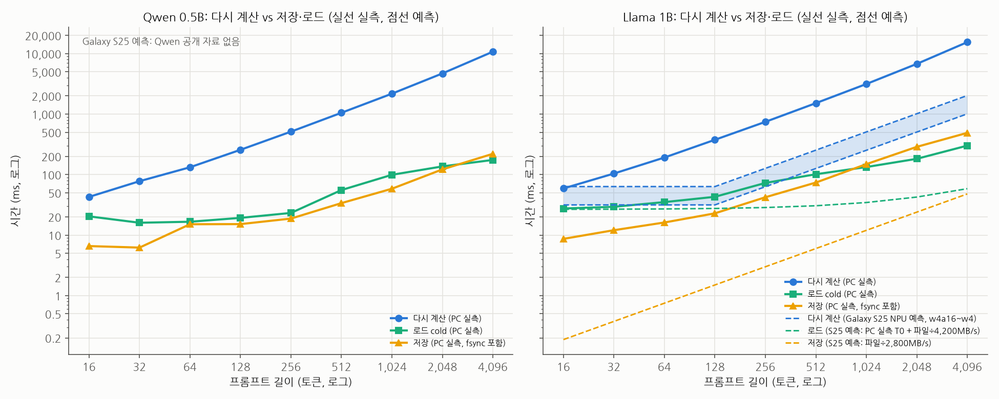
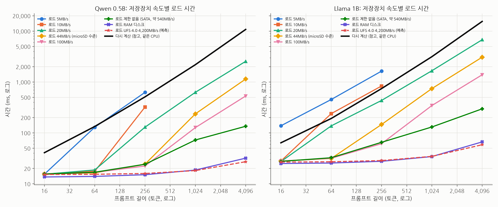
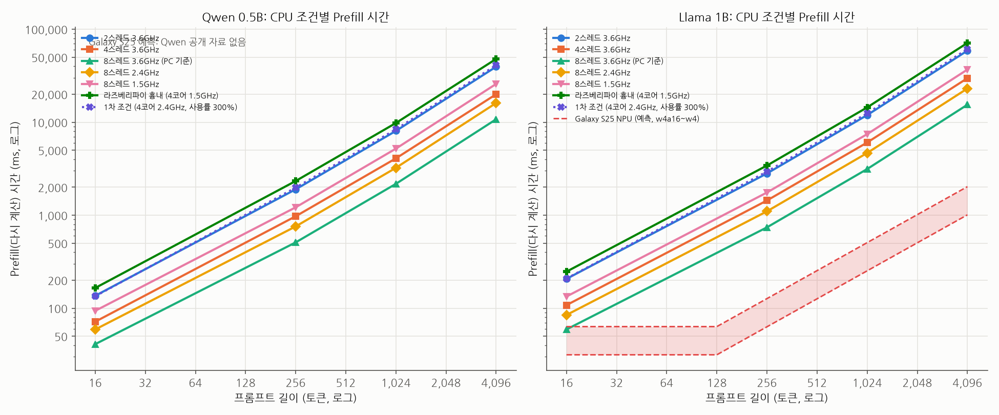
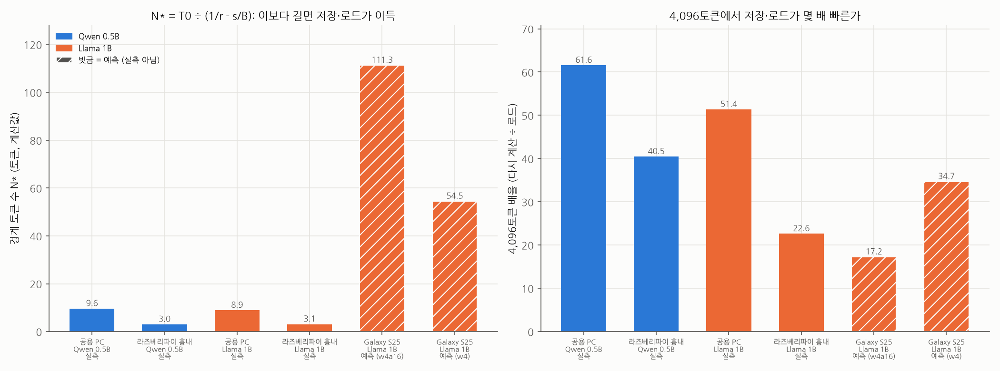

# KV Cache 저장·복원 vs 재계산: 온디바이스 LLM 벤치마크

가천대학교 AI P-실무프로젝트 SW 8조 · SK하이닉스 기업 수요 과제 "Linux 환경 On-Device AI 워크로드 분석"

PC 값은 2차 실험(2026-11-10, 공용 PC) 실측값이다. Galaxy S25 값은 공용 PC에서 검증한 규칙에 기기 공개 사양을 넣어 계산한 예측값이며 "예측"으로 표시한다. 전체 결과는 [docs/results/phase2/REPORT.md](docs/results/phase2/REPORT.md).

## 실험 배경

- 휴대폰·노트북 안에서 LLM을 직접 돌리는 온디바이스 AI가 확산되고 있다. 기기 안에서 돌아가므로 서버보다 연산·메모리·저장장치가 모두 작고 느리다.
- LLM은 대화를 읽을 때 이후 답변에 계속 쓰이는 중간 계산 결과인 KV Cache를 만든다. KV Cache는 대화가 길어질수록 커지고, 그동안 메모리를 계속 차지한다.
- 메모리가 부족하거나 앱을 다시 켜면 KV Cache가 사라진다. 그러면 다음 질문 때 <b>이전 대화 전체를 처음부터 다시 처리(Prefill)</b>해야 해서 첫 답변이 늦어진다.
- 대안은 KV Cache를 저장장치에 저장해 두었다가 불러오는(로드) 것이다. 다시 계산하지 않아도 되지만 저장장치를 읽는 시간이 든다.
- 즉 <b>"버리고 다시 계산할 것인가, 저장했다가 불러올 것인가"</b>의 문제이고, 답은 기기의 CPU(또는 NPU) 성능과 저장장치 속도에 따라 달라진다.
- 실제 상용 온디바이스 모델은 대화 하나를 4,096토큰 정도로 제한한다(애플 온디바이스 모델 기준, Apple TN3193). 그래서 이 프로젝트는 4,096토큰까지만 다룬다.

## 목적

- 대화 길이(토큰)에 따라 다시 계산(Prefill)하는 시간과 저장·로드하는 시간을 측정해 비교한다.
- 그 결과로 <b>"어떤 기준 이상이면 KV Cache를 저장장치에 저장하는 게 이득이고, 어떤 기준 이하면 버리고 다시 계산하는 게 이득인가"</b>를 정한다.
- 이 기준을 실제 상용 기기(iPhone 16 Pro, Galaxy S25)와 PC에 적용해, 기기별로 어떤 선택이 맞는지 제시한다.
- 이를 통해 연산(CPU·NPU) · 메모리(DRAM) · 저장장치(SSD·UFS)로 이어지는 메모리 계층과 추론 성능의 관계를 이해한다.

## 실험 방법

| 구분 | 내용 |
| --- | --- |
| 비교하는 두 방식 | ① KV Cache를 버리고 대화 전체를 다시 Prefill ② KV Cache를 저장장치에 저장해 두었다가 로드 |
| 측정 장비 | 공용 PC (Intel i7-9700K 8코어, 32GB, 실험용 SATA SSD Samsung 840 PRO), Ubuntu 26.04 |
| 추론 엔진 / 모델 | llama.cpp (CPU) / Qwen2.5 0.5B, Llama 3.2 1B (4비트, Q4_K_M) |
| 바꾼 조건 | 대화 길이(16~4,096토큰), CPU 성능(스레드·클럭), 저장장치 속도(5MB/s~RAM 디스크), 메모리 상한(4G~1.5G) |
| 검증 | 복원 후 답변이 원래 답변과 글자 하나까지 같은지 매번 확인 (2차 불일치 0건) |
| 반복 | 1차 40회, 2차 5회 (25조건, 전체 122분, 실패 0건) |

휴대폰 값은 공용 PC에서 검증한 규칙 <b>(손익분기 저장장치 속도 B* = 토큰당 KV 크기 × Prefill 속도)</b>에 아래 기기 사양을 넣어 계산했다.

| 기기 | 칩 | RAM | 저장장치 | Llama 1B Prefill 속도 | 출처 |
| --- | --- | --- | --- | --- | --- |
| Galaxy S25 | Snapdragon 8 Elite for Galaxy | 12GB | UFS 4.0 (읽기 4,200 / 쓰기 2,800MB/s) | 약 2,018~4,055 토큰/s (4,096토큰 첫 토큰까지 1.01~2.03초에서 계산) | Notebookcheck, Samsung UFS 4.0, Qualcomm Llama 3.2 1B |
| iPhone 16 Pro | A18 Pro | 8GB | 공개 자료 없음 | 공개 자료 없음 | MacRumors (RAM) |
| PC (공용 PC) | Intel i7-9700K | 32GB | SATA SSD (읽기 실측 539MB/s, 쓰기 341MB/s) | 327 토큰/s (Qwen 473) | 2차 실험 실측 |

## 결과

### 1. 다시 계산하는 시간 vs 저장·로드하는 시간 (토큰별)

모델: Llama 3.2 1B. PC는 실측(반복 5회 평균, cold = 페이지 캐시를 비우고 SSD에서 읽음), Galaxy S25는 예측.

| 대화 길이 | PC: 다시 계산 | PC: 저장 | PC: 로드 | PC: 배율 | Galaxy S25: 다시 계산 (예측) | Galaxy S25: 저장 (예측) | Galaxy S25: 로드 (예측) | iPhone 16 Pro |
| --- | --- | --- | --- | --- | --- | --- | --- | --- |
| 16토큰 | 59.1ms | 8.7ms | 27.5ms | 2.1배 | 32~63ms | 0.2ms | 26.7ms | 공개 자료 없음 |
| 256토큰 | 745.2ms | 42.2ms | 72.8ms | 10.2배 | 63~127ms | 3.0ms | 28.6ms | 공개 자료 없음 |
| 1,024토큰 | 3,145.1ms | 148.9ms | 133.5ms | 23.6배 | 253~508ms | 12.0ms | 34.6ms | 공개 자료 없음 |
| 4,096토큰 | 15,475.0ms | 490.2ms | 301.3ms | 51.4배 | 1,010~2,030ms | 48.0ms | 58.5ms | 공개 자료 없음 |



- PC에서는 16토큰부터 로드가 다시 계산보다 빠르다(Qwen 4,096토큰은 61.6배).
- 짧은 길이의 로드 시간은 파일 읽기보다 <b>기본 비용 T0(Llama 약 27ms)</b>가 대부분이다.
- 저장 비용까지 합쳐도 64토큰 이상은 저장한 KV를 한 번만 다시 써도 본전이다(16토큰은 두 번).
- Galaxy S25 예측: Prefill은 Qualcomm TTFT를 128토큰 단위 처리로 나눠 계산했다. 로드는 PC 실측 T0 + 파일 크기 ÷ 4,200MB/s, 저장은 파일 크기 ÷ 2,800MB/s로 계산했다.

### 2. 저장장치별 로드 시간 (토큰별)

모델: Llama 3.2 1B. 토큰당 KV 크기 32,784B (4,096토큰 ≈ 134MB). 같은 CPU에서 다시 계산은 59ms / 745ms / 3,145ms / 15,475ms.

| 저장장치 (읽기 속도) | 16토큰 | 256토큰 | 1,024토큰 | 4,096토큰 | 측정 |
| --- | --- | --- | --- | --- | --- |
| 5MB/s | **138.0ms** | **1,634.9ms** | 미측정 | 미측정 | 실측 (속도 제한) |
| 10MB/s | 28.0ms\* | **834.1ms** | 미측정 | 미측정 | 실측 (속도 제한) |
| 20MB/s | 27.3ms\* | 434.0ms | 1,663.2ms | 6,762.7ms | 실측 (속도 제한) |
| 44MB/s (라즈베리파이 microSD 수준) | 28.0ms\* | 146.2ms | 742.2ms | 3,071.8ms | 실측 (속도 제한) |
| 100MB/s (1차 실험 조건) | 27.9ms\* | 61.5ms | 344.6ms | 1,386.5ms | 실측 (속도 제한) |
| SATA SSD 제한 없음 (548MB/s) | 27.6ms | 65.4ms | 130.7ms | 297.1ms | 실측 |
| UFS 4.0 (Galaxy S25, 4,200MB/s) | 26.7ms | 28.6ms | 34.6ms | 58.5ms | 예측 |
| RAM 디스크 (저장장치 속도의 상한, 약 9.7GB/s) | 25.1ms | 27.7ms | 34.3ms | 66.6ms | 실측 (warm) |

굵은 값 = 다시 계산보다 느림(저장이 손해). \* 0.5MB짜리 짧은 파일에는 cgroup 속도 제한이 다 걸리지 않아 실제 느린 저장장치보다 빠르게 측정됨.



- 손익분기점을 직접 관측했다. 256토큰에서 Llama는 10MB/s 이하, Qwen은 5MB/s에서 로드가 다시 계산보다 느려졌다.
- 실측 교차점(Llama 11.29MB/s, Qwen 6.16MB/s)은 식 B\* = s × r의 계산값(11.32, 6.17MB/s)과 0.2% 오차로 맞았다.
- 긴 대화에서는 로드 시간이 거의 파일 크기 ÷ 읽기 속도다(4,096토큰: 20 → 44 → 100MB/s에서 6.8 → 3.1 → 1.4초).

### 3. CPU별 Prefill 시간 (토큰별)

모델: Llama 3.2 1B.



| CPU 조건 | 16토큰 | 256토큰 | 1,024토큰 | 4,096토큰 | Prefill 속도 (1,024토큰) |
| --- | --- | --- | --- | --- | --- |
| 공용 PC 8스레드 3.6GHz (제한 없음) | 0.06초 | 0.74초 | 3.1초 | 15.4초 | 326 토큰/s |
| 4스레드 3.6GHz | 0.11초 | 1.4초 | 6.1초 | 29.8초 | 169 토큰/s |
| 2스레드 3.6GHz | 0.21초 | 2.8초 | 11.9초 | 58.9초 | 86 토큰/s |
| 8스레드 2.4GHz | 0.08초 | 1.1초 | 4.7초 | 23.1초 | 219 토큰/s |
| 8스레드 1.5GHz | 0.13초 | 1.8초 | 7.4초 | 36.9초 | 137 토큰/s |
| 라즈베리파이 4 흉내 (4코어 1.5GHz) | 0.25초 | 3.4초 | 14.4초 | 71.3초 | 71 토큰/s |
| 1차 실험 조건 (4코어 2.4GHz, 300%) | 0.21초 | 2.9초 | 12.5초 | 61.3초 | 82 토큰/s |
| Galaxy S25 NPU (예측) | 0.03~0.06초 | 0.06~0.13초 | 0.25~0.51초 | 1.0~2.0초 | 약 2,018~4,055 토큰/s |

- Prefill 속도는 CPU에 거의 비례한다(스레드 2배 → 1.9~2.0배, 클럭 2.4배 → 2.4배).
- 로드 시간은 CPU와 거의 무관하다(4,096토큰 cold: 2스레드 354ms vs 8스레드 291ms). 그래서 CPU가 느릴수록 저장이 더 유리하다.
- 1차 실험 조건 재현값은 1차 측정과 1% 안에서 일치했다(2차 코드가 측정값을 바꾸지 않음).

### 4. 2차 실험 결론: 언제 저장하고, 언제 버릴 것인가

| 기기 | 이 이상이면 저장 후 로드가 이득 | 이 이하면 버리고 다시 계산이 이득 | 4,096토큰 기준 차이 | 근거 |
| --- | --- | --- | --- | --- |
| PC (공용 PC, SATA SSD) | 저장장치 읽기 10.7MB/s 이상(Qwen 5.8), 측정한 모든 길이(16토큰~) | 읽기 10.7MB/s 이하 (계산 경계 약 9토큰 미만) | 51.4배 (Qwen 61.6) | 실측 |
| 라즈베리파이급 (4코어 1.5GHz, 44MB/s) | 저장장치 읽기 2.3MB/s 이상(Qwen 1.3), 측정한 모든 길이(16토큰~) | 읽기 2.3MB/s 이하 (계산 경계 약 3토큰 미만) | 22.6배 (Qwen 40.5) | 실측 (흉내) |
| Galaxy S25 | 저장장치 읽기 66~133MB/s 이상(UFS 4.0은 4,200MB/s로 충분), 대화 약 55~110토큰 이상 | 약 55~110토큰 미만 (128토큰 단위 처리라면 이 구간도 저장이 1.2~2.4배 빠르지만 차이는 작음) | 17~35배 | 예측 |
| iPhone 16 Pro | 공개 자료 없음 | 공개 자료 없음 | - | Prefill·저장장치 속도 공개 자료가 없어 실측 필요 |



PC와 Galaxy S25 모두 저장장치가 손익분기 속도(B\*)보다 수십 배 빨라, 4,096토큰 이하 범위에서는 거의 모든 길이에서 KV Cache를 저장했다가 불러오는 쪽이 이득이다. 다시 계산이 더 나은 경우는 두 가지다. 하나는 저장장치 읽기가 B\*보다 느린 경우이고(PC 기준 약 11MB/s 이하), 다른 하나는 Galaxy S25처럼 NPU Prefill이 빠른 기기에서 수십 토큰 이하의 짧은 대화다. 메모리 상한 1.5G에서도 4,096토큰 복원 시 스래싱은 생기지 않았다.

## 향후 진행 방향

이번 결과(속도 비교)와는 별개로, 메모리 한계를 조사한다.

- **대화 길이에 따른 저장 용량과 로드 시간**: 대화가 길어질수록 KV Cache와 저장 파일이 커진다. 대화 길이(토큰)별로 KV Cache 크기와, iPhone 16 Pro·Galaxy S25·PC에서 저장하고 불러오는 데 걸리는 시간을 조사한다.
- **최종 목표: 기기별 메모리 한계 측정**
  - 휴대폰: 대화 길이(토큰)별로 동시에 몇 개의 대화창을 메모리에 둘 수 있는지
  - 휴대폰: 대화창 하나에서 몇 토큰을 넘으면 메모리 때문에 더 이상 돌아가지 않는지
  - PC: 위 두 항목을 같은 방식으로 측정

대화를 계속 이어 가면 KV Cache가 점점 커져 결국 메모리가 부족해 쓸 수 없게 된다. 이를 최대한 늦추기 위해, 상용 온디바이스 모델에서 실제로 쓰는 <b>KV Cache 크기 줄이기 방법(8비트 KV 양자화)</b>을 적용한다. 애플 온디바이스 모델도 KV Cache를 8비트로 저장하며(Apple), 적용하면 현재(16비트) 대비 KV Cache 크기가 약 2분의 1로 줄어 메모리·저장 파일·로드 시간이 함께 줄어든다. 줄이기 전과 후의 동시 대화창 수, 대화창당 최대 토큰 수, 답변 품질 변화를 비교한다.

## 실행 방법 (요약)

```bash
cd ~/aiwork/P-project
PY=~/aiwork/venv/bin/python
$PY scripts/run_sweep.py configs/phase2/D1.json                          # 단계 하나 (D1~D5)
$PY scripts/run_sweep.py configs/phase2/D2.json --only read44M,nolimit   # 조건 일부만
$PY scripts/run_sweep.py configs/phase2/D*.json --dry-run                # 실행할 명령만 보기
$PY scripts/analyze_results.py                                           # 분석 표 (analysis/)
$PY scripts/plot_results.py                                              # 그래프 (plots/, fig1~fig9)
```

조건 하나만 실행할 때는 GitHub Actions → kv-bench → Run workflow. 공용 PC 구성은 [docs/SETUP.md](docs/SETUP.md), 실험 설계는 [docs/EXPERIMENTS.md](docs/EXPERIMENTS.md), 전체 결과는 [docs/results/phase2/REPORT.md](docs/results/phase2/REPORT.md).

## 1차 실험 결과 (2026-10-29, 참고)

저사양 조건(CPU 4코어 2.4GHz, 저장장치 읽기 100MB/s) 한 가지에서 측정. 모든 길이에서 로드가 다시 계산보다 6~75배 빨랐고, 2,880회 모두 복원 후 답변이 같았다. LZ4 압축은 파일이 약 1.5%만 줄어 이득이 없었다. CPU와 저장장치를 모두 크게 낮춘 조건이라 상용 기기 결론으로 쓰지 않고, 2차 실험의 출발점으로만 쓴다.
