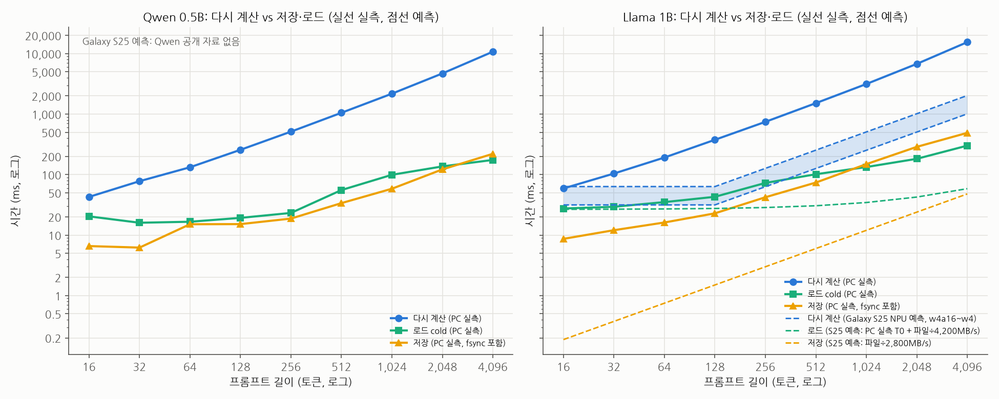
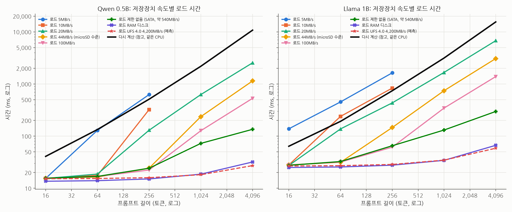
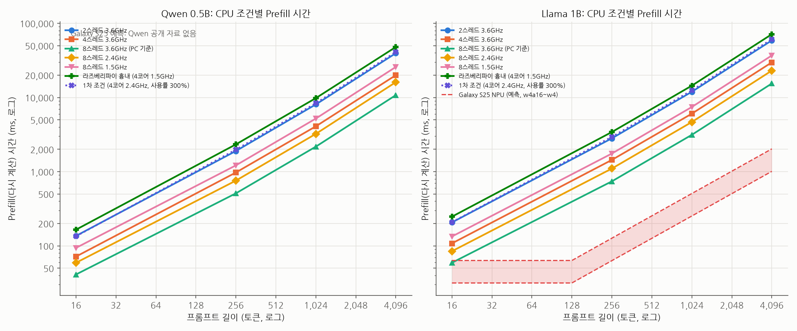
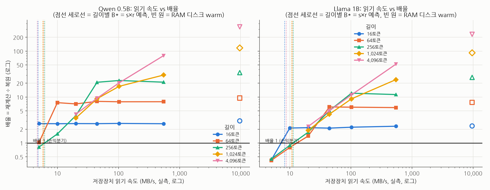
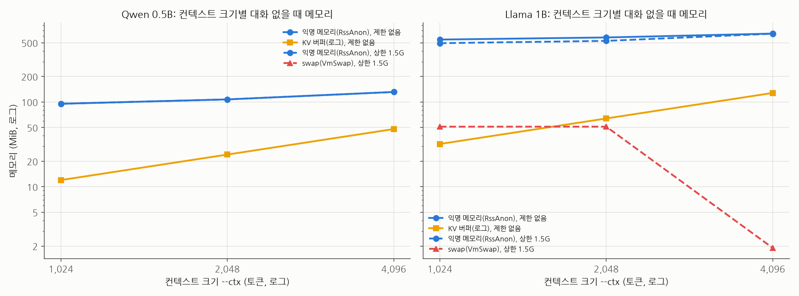
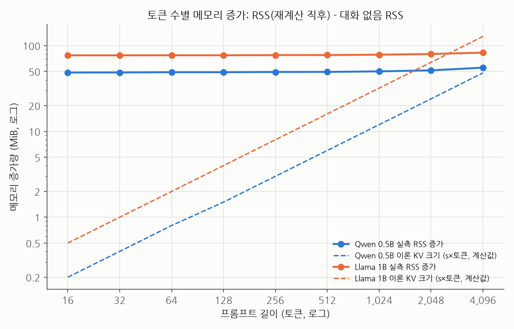
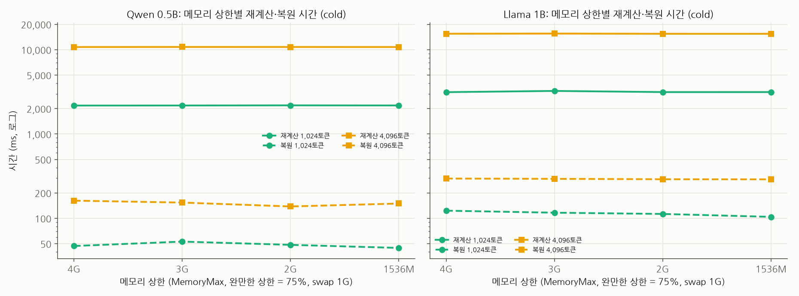
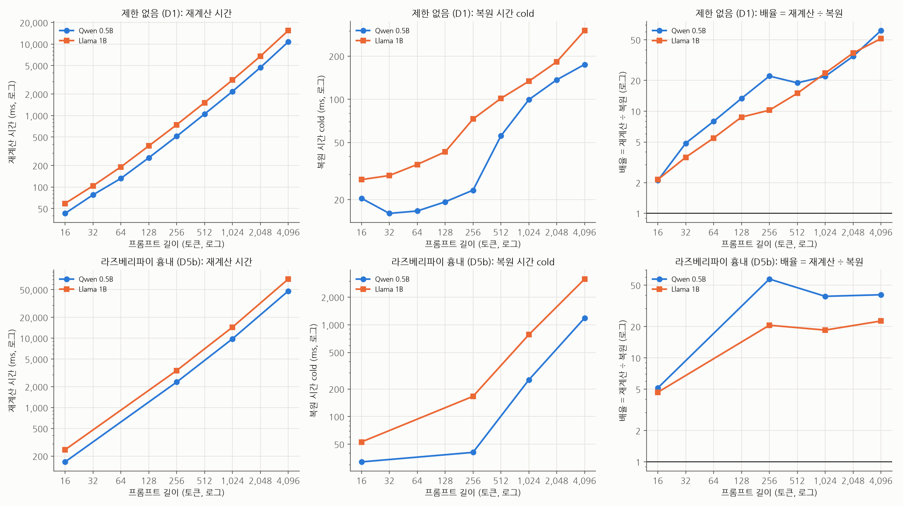
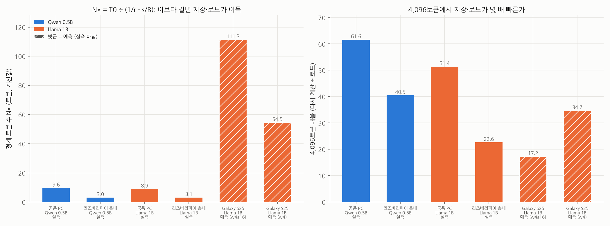

# 2차 실험 보고서: KV Cache 저장·로드 vs 다시 계산의 경계

가천대 SW 8조 · SK하이닉스 기업 과제 "Linux 환경 On-Device AI 워크로드 분석" · 측정 2026-11-10 (공용 PC)

## 한 줄 결론

**4,096토큰 이하 실제 온디바이스 범위에서는 공용 PC(SATA SSD)와 라즈베리파이 흉내(읽기 44MB/s) 모두 측정한 모든 길이(16토큰~)에서 저장·로드가 다시 계산보다 빨랐다(4,096토큰 기준 22~62배, 실측).** 저장이 손해가 되는 것은 저장장치 읽기 속도가 **B\* = s×r(Qwen 약 5.8MB/s, Llama 약 10.7MB/s, PC CPU 기준)보다 느릴 때**뿐이며, 이 식은 실측 교차점과 **0.2% 오차**로 맞았다(256토큰). Galaxy S25(Llama 1B)는 NPU Prefill이 빨라 경계가 **약 55~110토큰(계산·예측값)**으로 올라가지만, 4,096토큰에서는 여전히 **17~35배(예측)** 저장이 유리하다.

---

## 1. 실험 환경

| 항목 | 값 |
| --- | --- |
| CPU | Intel Core i7-9700K 8코어 8스레드, 거버너 performance, 터보 끔, 최대 3600MHz |
| 메모리 | 30GiB(31,182MiB). 실험 전 OS·상주 프로세스 사용 1,128MiB, 사용 가능 30,053MiB, swap 8GiB(실험 SSD 위, 사용 0) |
| 실험 SSD | Samsung 840 PRO 128GB SATA (`/mnt/ssd`, ext4 noatime, TRIM 꺼짐) |
| 저장장치 실측 (fio, 1GB, 제한 없음) | 순차 읽기 493.0MB/s(direct) · 538.5MB/s(캐시 비운 뒤 버퍼 읽기 = cold 복원 경로), 순차 쓰기 340.8MB/s |
| OS | Ubuntu 26.04.1 LTS, 커널 7.0.0-38 |
| 추론 엔진 | llama.cpp `85cc432e2` (CPU 빌드), `-np 1`, KV f16 |
| 모델 | Qwen2.5-0.5B-Instruct, Llama-3.2-1B-Instruct (둘 다 GGUF Q4_K_M, SHA256 확인) |
| 측정 코드 | 저장소 `exp/phase2` 커밋 `52483df`~`5005dc1` (`meta.json`의 `bench_repo_commit`에 조건별 기록) |
| 컨텍스트 | 모든 단계 `--ctx 4192` (llama.cpp가 256 배수로 올려 실제 n_ctx 4,352) |

환경 점검 전체: `env_check.md`.

## 2. 실험 조건

공통: 두 모델 모두, RAW 저장, 워밍업 2, 생성 32토큰, cold = 전체 페이지 캐시 비움, **반복 5회**, 조건 시작마다 kv-dir 읽기·쓰기 속도 실측, llama-server `-lv 4`(KV 버퍼 크기 기록). **처리 길이 최대 4,096토큰** (실제 온디바이스 세션 한도 기준).

| 단계 | 조건 | 길이 (토큰) | 캐시 | 소요 |
| --- | --- | --- | --- | --- |
| D1 제한 없는 기준선 | 제한 없음 | 16~4,096 (2배씩) | cold, warm | 7.8분 |
| D2 저장장치만 | 읽기 5M·10M (16·64·256만), 20M, 44M, 100M, 제한 없음, RAM 디스크 | 16, 64, 256, 1,024, 4,096 | cold (RAM 디스크 warm) | 25.9분 |
| D3 CPU만 | (a) 3.6GHz + 2·4·8스레드 (b) 8스레드 + 1.5·2.4·3.6GHz | 16, 256, 1,024, 4,096 | cold | 38.6분 |
| D4 메모리 | ctx 1,024·2,048·4,096 대화 없을 때 메모리 (제한 없음·1.5G), 상한 4G·3G·2G·1.5G (mem-high 75%, swap 1G). 서버 시작 전 캐시 비움 | 1,024, 4,096 | cold | 16.0분 |
| D5 저사양 프리셋 | (b) 라즈베리파이 흉내: 4코어 1.5GHz, 읽기 44MB/s·쓰기 20MB/s / (a) 1차 조건 재현 | 16, 256, 1,024, 4,096 | cold, warm | 33.6분 |

**전체 25조건 모두 정상 종료 (실패·서버 종료 0건), 출력 불일치 0건, 전체 121.9분** (2026-11-10 17:56~19:58). 각 조건 뒤 KV 파일·llama-server·CPU 클럭·io 제한이 모두 정리된 것을 확인했다.

출처: `~/aiwork/results/phase2/D*/sweep_status.csv`

## 3. 결과

### 3.1 D1 제한 없는 기준선 (공용 PC = PC 등급)

| 모델 | 길이 | 다시 계산 (ms) | 로드 cold (ms) | 배율 cold | 로드 warm (ms) | 배율 warm | 저장 (ms, fsync 포함) | 본전 재사용 횟수 |
| --- | --- | --- | --- | --- | --- | --- | --- | --- |
| Qwen | 16 | 42.8 ± 2.2 | 20.4 ± 5.7 | 2.1 | 13.6 ± 0.3 | 3.1 | 6.6 ± 2.1 | 1.20 |
| Qwen | 256 | 513.4 ± 3.7 | 23.3 ± 2.7 | 22.1 | 14.9 ± 0.1 | 34.5 | 18.8 ± 2.2 | 0.09 |
| Qwen | 1,024 | 2,177.0 ± 5.7 | 99.3 ± 21.6 | 21.9 | 18.1 ± 0.2 | 120.5 | 58.4 ± 5.2 | 0.08 |
| Qwen | 4,096 | 10,765.7 ± 19.9 | 174.9 ± 12.8 | 61.6 | 29.8 ± 0.2 | 360.8 | 220.9 ± 34.9 | 0.04 |
| Llama | 16 | 59.1 ± 0.1 | 27.5 ± 0.4 | 2.1 | 25.0 ± 0.1 | 2.4 | 8.7 ± 2.5 | 1.15 |
| Llama | 256 | 745.2 ± 7.0 | 72.8 ± 3.6 | 10.2 | 27.5 ± 0.0 | 27.1 | 42.2 ± 4.0 | 0.17 |
| Llama | 1,024 | 3,145.1 ± 7.5 | 133.5 ± 25.3 | 23.6 | 35.4 ± 2.3 | 88.8 | 148.9 ± 12.8 | 0.09 |
| Llama | 4,096 | 15,475.0 ± 8.5 | 301.3 ± 11.4 | 51.4 | 64.2 ± 0.6 | 241.2 | 490.2 ± 34.2 | 0.05 |

평균 ± 표준편차, 반복 5회. 출처: `~/aiwork/results/phase2/D1/nolimit/`

- 제한 없는 PC에서는 **16토큰에서도 로드가 2배 빠르고**, 4,096토큰에서는 Qwen 62배, Llama 51배 빠르다.
- 로드 시간은 16~256토큰에서 거의 일정(약 15~70ms)하다. 파일을 읽는 시간보다 **기본 비용 T0(Qwen 20ms, Llama 27ms)**가 크기 때문이다.
- 1차(저사양 조건)보다 다시 계산이 약 3.8배 빨라졌지만(Qwen 4,096: 41.1초 → 10.8초), 로드도 SSD 제한이 풀려 빨라져 배율 자체는 비슷한 수준(Qwen 61.6 vs 1차 74.9)이다.

### 3.2 D2 저장장치 속도만 변경 → 손익분기점 직접 관측

| 읽기 상한 (실측 MB/s) | Qwen 256토큰 배율 | Qwen 4,096 배율 | Llama 256토큰 배율 | Llama 4,096 배율 |
| --- | --- | --- | --- | --- |
| 5M (4.99) | **0.82** | 미측정 | **0.45** | 미측정 |
| 10M (9.99) | 1.58 | 미측정 | **0.89** | 미측정 |
| 20M (19.98) | 3.94 | 4.23 | 1.72 | 2.29 |
| 44M (44.55) | 20.99 | 9.42 | 5.07 | 5.05 |
| 100M (102.3) | 22.93 | 20.36 | 12.14 | 11.18 |
| 제한 없음 (547.6) | 21.10 | 79.79 | 11.34 | 52.11 |
| RAM 디스크 (warm, 9,668) | 33.97 | 338.0 | 26.75 | 232.47 |

굵은 값 = 배율 < 1 (저장·로드가 다시 계산보다 느림, 실측). 5M·10M은 시간 절약을 위해 16·64·256토큰만 측정. 출처: `~/aiwork/results/phase2/D2/*/`

- **손익분기점을 직접 관측했다.** Llama는 5MB/s·10MB/s, Qwen은 5MB/s에서 256토큰 배율이 1 아래로 떨어졌다.
- 길이가 길어질수록 배율은 읽기 속도에 거의 비례한다 (Llama 4,096: 20M → 2.29배, 44M → 5.05배, 100M → 11.18배). 이 구간에서는 로드 시간 = 파일 크기 ÷ 읽기 속도가 지배한다.
- RAM 디스크(약 9.7GB/s)에서는 Llama 4,096토큰 로드가 66.6ms로, 휴대폰 UFS 4.0(4,200MB/s) 예측 로드(58.5ms)와 비슷한 수준이다.

### 3.3 D3 CPU만 변경

| 조건 | Qwen r (토큰/s, 1,024) | Qwen 다시 계산 4,096 (ms) | Qwen 배율 4,096 | Llama r (토큰/s, 1,024) | Llama 다시 계산 4,096 (ms) | Llama 배율 4,096 | B\* Qwen / Llama (MB/s, 계산값) |
| --- | --- | --- | --- | --- | --- | --- | --- |
| 2스레드 3.6GHz | 127 | 39,556.3 ± 24.7 | 236.9 | 86 | 58,872.7 ± 8.1 | 166.3 | 1.56 / 2.80 |
| 4스레드 3.6GHz | 250 | 20,001.8 ± 1.6 | 137.9 | 169 | 29,773.3 ± 6.2 | 96.0 | 3.07 / 5.53 |
| 8스레드 3.6GHz | 471 | 10,767.7 ± 12.0 | 75.8 | 326 | 15,445.0 ± 12.8 | 53.1 | 5.78 / 10.67 |
| 8스레드 2.4GHz | 316 | 16,108.2 ± 42.0 | 98.3 | 219 | 23,056.6 ± 14.9 | 76.0 | 3.88 / 7.16 |
| 8스레드 1.5GHz | 197 | 25,839.2 ± 52.6 | 159.9 | 137 | 36,864.2 ± 16.1 | 110.9 | 2.41 / 4.49 |

r = 길이 ÷ 다시 계산 시간. B\* = s × r_fit(1,024토큰 이하 직선 맞춤). 출처: `~/aiwork/results/phase2/D3/*/`

- Prefill 속도는 CPU에 거의 비례한다: 스레드 2배 → r 1.88~1.97배, 클럭 1.5 → 3.6GHz(2.4배) → r 2.38~2.39배 (두 모델 모두).
- 로드 시간은 CPU와 거의 무관하다 (Llama 4,096 cold: 2스레드 354ms vs 8스레드 291ms). 그래서 **CPU가 느릴수록 배율이 커지고 B\*는 작아진다** (느린 CPU일수록 느린 저장장치로도 저장이 이득).

### 3.4 D5 저사양 기기: 라즈베리파이 흉내 (b) 중심

| 모델 | 길이 | 다시 계산 (ms) | 로드 cold (ms) | 배율 cold | 배율 warm | 저장 (ms) | 본전 재사용 횟수 |
| --- | --- | --- | --- | --- | --- | --- | --- |
| Qwen | 16 | 165.1 ± 0.1 | 32.1 ± 0.1 | 5.1 | 5.5 | 9.4 ± 4.6 | 0.31 |
| Qwen | 256 | 2,333.8 ± 0.4 | 40.7 ± 0.3 | 57.3 | 68.7 | 182.6 ± 4.5 | 0.10 |
| Qwen | 1,024 | 9,812.4 ± 4.7 | 251.1 ± 2.3 | 39.1 | 227.8 | 665.7 ± 3.8 | 0.10 |
| Qwen | 4,096 | 47,980.3 ± 22.4 | 1,186.1 ± 3.2 | 40.5 | 604.1 | 2,582.3 ± 3.2 | 0.08 |
| Llama | 16 | 247.3 ± 0.1 | 52.9 ± 0.2 | 4.7 | 4.9 | 11.9 ± 1.8 | 0.33 |
| Llama | 256 | 3,422.9 ± 0.6 | 166.2 ± 2.1 | 20.6 | 59.7 | 468.5 ± 3.8 | 0.19 |
| Llama | 1,024 | 14,443.6 ± 4.7 | 780.2 ± 3.3 | 18.5 | 186.6 | 1,735.3 ± 4.9 | 0.18 |
| Llama | 4,096 | 71,295.5 ± 42.5 | 3,151.8 ± 2.1 | 22.6 | 425.4 | 6,824.0 ± 6.7 | 0.15 |

출처: `~/aiwork/results/phase2/D5/rpi_like/`

- 라즈베리파이급(4코어 1.5GHz, microSD 수준 읽기 44MB/s)에서도 **16토큰부터 저장이 4.7~5.1배 빠르다**. CPU가 PC보다 약 4.5배 느려(r: Qwen 104, Llama 71토큰/s) B\*가 1.3~2.3MB/s로 떨어지므로 44MB/s 저장장치로도 충분하다.
- 4,096토큰 저장(쓰기 20MB/s)은 Llama 6.8초로 다시 계산(71.3초)의 10%이고, 저장 1번을 1번만 재사용해도 본전이다(본전 재사용 횟수 0.15).

**(a) 1차 조건 재현 (코드 호환 확인용 참고)**: 같은 조건에서 1차(2026-10-29)와 다시 계산·로드 시간이 1% 안에서 일치했다 (예: Qwen 4,096 다시 계산 41,089ms vs 1차 41,133ms, 로드 548.7ms vs 549.1ms; Llama 4,096 61,258ms vs 60,997ms, 1,428ms vs 1,431ms). 2차 코드 변경이 측정값을 바꾸지 않았음을 확인했다. 출처: `~/aiwork/results/phase2/D5/phase1_repro/`

## 4. 손익분기식 검증

### 4.1 B\* = s × r (D2: 예측 vs 실측 교차)

| 모델 | 길이 | 실측 교차 B (MB/s, 로그 보간) | B\* = s×r (계산값) | 오차 | B\*_T0 = N·s/(다시 계산 − T0) (계산값) | 오차 |
| --- | --- | --- | --- | --- | --- | --- |
| Qwen | 256 | 6.16 | 6.17 | **+0.2%** | 6.35 | +3.1% |
| Llama | 256 | 11.29 | 11.32 | **+0.2%** | 11.74 | +4.0% |
| Llama | 64 | 13.08 | 10.93 | −16.4% | 12.69 | −3.0% |
| Llama | 16 | 7.2 | 8.21 | +14.0% | 14.07 | +95.3% |
| Qwen | 16·64 | 관측 안 됨 (5MB/s에서도 배율 2.65·1.03) | 4.82·5.89 | - | 7.67·6.65 | - |
| 두 모델 | 1,024·4,096 | 관측 안 됨 (20MB/s에서도 배율 1.9~4.2, 5·10M은 미측정) | 4.7~10.7 | - | - | - |

s(바이트/토큰, RAW 파일 크기 직선 맞춤): **Qwen 12,304, Llama 32,784** (1차 값과 같음). 출처: `~/aiwork/results/phase2/analysis/d2_crossover.csv`

- **256토큰에서는 단순식 B\* = s×r가 실측 교차점과 0.2% 오차로 맞았다** (두 모델 모두).
- 맞지 않는 구간의 원인:
  - **16·64토큰**: 파일이 0.2~2MB로 작아 **cgroup io.max 제한이 다 걸리지 않는다** (예: Qwen 16토큰 파일 0.2MB를 5MB/s 제한에서 111MB/s로 읽음, Qwen 256토큰 3.1MB를 44MB/s 제한에서 321MB/s로 읽음). 그래서 짧은 길이는 제한 속도보다 빨리 로드되어 교차점이 실제보다 낮게 보인다. 실제 느린 저장장치에서는 이 짧은 구간도 B\* 근처에서 교차할 것으로 본다(계산).
  - 또 짧은 길이는 T0(기본 비용)가 커서 T0를 넣은 B\*_T0가 더 맞는다 (Llama 64토큰 −3.0%).
  - **1,024·4,096토큰**은 B\*(5~11MB/s)보다 느린 조건(5M·10M)을 측정하지 않아 교차를 관측하지 못했다.

### 4.2 N\* = T0 ÷ (1/r − s/B) (경계 토큰 수)

| 조건 | Qwen T0 (ms) | Qwen N\* (계산값) | Llama T0 (ms) | Llama N\* (계산값) | 실측 |
| --- | --- | --- | --- | --- | --- |
| D1 PC 제한 없음 | 20.0 | 9.6 | 26.6 | 8.9 | 두 모델 모두 16토큰부터 배율 > 1 (N\* < 16 관측과 일치) |
| D3 8스레드 1.5GHz | 26.0 | 5.1 | 43.5 | 6.0 | 16토큰부터 배율 > 1 |
| D5 라즈베리파이 흉내 | 27.7 | 3.0 | 41.1 | 3.1 | 16토큰부터 배율 > 1 |
| D2 읽기 10MB/s | 15.2 | 20.9 | 26.6 | ∞ (s/B > 1/r) | Llama: 64·256토큰 배율 0.80·0.89 (손해) |
| D2 읽기 5MB/s | 15.2 | ∞ | 26.6 | ∞ | Llama 모든 길이, Qwen 256토큰 손해 |

T0 = 16토큰 로드 시간 − 16토큰 파일 크기 ÷ 실측 읽기 속도. D2 읽기 제한 조건은 위 io.max 문제로 같은 CPU의 D2 제한 없음 T0를 썼다. ∞ = 토큰당 로드 비용(s/B)이 토큰당 계산 비용(1/r)보다 커서, 길수록 다시 계산이 유리. 출처: `~/aiwork/results/phase2/analysis/per_condition.csv`

- 측정 범위(16토큰 이상)에서 N\*를 직접 관측할 수 있는 것은 저장장치가 B\*보다 느린 경우뿐이었고, 그때는 식대로 "모든 길이에서 손해(∞)" 또는 짧은 길이에서만 이득이 나타났다.

## 5. 메모리 분석

### 5.1 KV 버퍼는 토큰 수가 아니라 컨텍스트 크기로 미리 잡힌다

| 모델 | ctx | KV 버퍼 (MiB, 로그) | 이론 s×ctx (MiB, 계산값) | 계산 버퍼 (MiB) | REPACK (MiB) | 대화 없을 때 RSS (MiB) | 익명 / 파일 (MiB) |
| --- | --- | --- | --- | --- | --- | --- | --- |
| Qwen | 1,024 | 12.0 | 12.0 | 38.3 | 28.1 | 576.1 | 95.4 / 480.7 |
| Qwen | 4,096 | 48.0 | 48.1 | 41.3 | 28.1 | 612.1 | 131.4 / 480.7 |
| Llama | 1,024 | 32.0 | 32.0 | 69.0 | 445.5 | 1,326.8 | 545.8 / 781.0 |
| Llama | 4,096 | 128.0 | 128.1 | 72.0 | 445.5 | 1,422.7 | 641.8 / 780.9 |

메모리 제한 없음, 서버 시작 전 페이지 캐시 비움. 출처: `~/aiwork/results/phase2/D4/idle_ctx*/meta.json`, `analysis/d4_ctx_idle.csv`

- **KV 버퍼 크기 = s × ctx가 정확히 맞는다** (오차 0.1MiB 이하). llama.cpp는 서버 시작 때 컨텍스트 전체 KV를 잡아 두므로, 고정 ctx(4,352)에서는 **처리 토큰 수가 늘어도 RSS가 거의 늘지 않는다**: D1에서 16 → 4,096토큰일 때 RSS 증가(대화 없음 대비)가 Qwen 48.6 → 55.4MiB, Llama 77.1 → 82.9MiB (이론 KV는 0.5 → 128MiB). 증가분 대부분은 계산 버퍼다.
- Llama는 Q4_K 가중치를 CPU용으로 다시 배열한 **REPACK 버퍼 445.5MiB**(익명 메모리)가 따로 있어 Qwen보다 메모리를 훨씬 많이 쓴다 (모델 파일 mmap 약 780MiB + 익명 약 640MiB).

### 5.2 메모리 상한과 swap

| 모델 | 상한 | 길이 | 다시 계산 (ms) | 로드 (ms) | 배율 | swap (MiB, 로드 후 최대) | vmstat 스왑인 / 스왑아웃 (KiB) |
| --- | --- | --- | --- | --- | --- | --- | --- |
| Llama | 4G | 4,096 | 15,484.5 | 296.7 | 52.2 | 0 | 0 / 0 |
| Llama | 2G | 4,096 | 15,466.9 | 291.2 | 53.1 | 3.1 | 104 / 0 |
| Llama | 1.5G | 1,024 | 3,147.9 | 104.2 | 30.2 | 23.5 | 363,396 / 374,040 |
| Llama | 1.5G | 4,096 | 15,464.1 | 290.3 | 53.3 | 17.9 | 169,528 / 4 |
| Qwen | 1.5G | 4,096 | 10,770.6 | 149.9 | 71.8 | 0 | 0 / 0 |

반복 5회 평균. 출처: `~/aiwork/results/phase2/D4/mem*/`, `analysis/d4_pressure.csv`

- **1.5G에서 4,096토큰일 때 스래싱은 생기지 않았다.** Llama는 모델 로드 직후부터 swap이 약 20~50MiB 생기지만(1.5G 상한의 완만한 상한 1,152MiB < 모델 파일 약 780MiB + 익명 약 640MiB), 다시 계산은 4G와 0.2% 안에서 같고 로드는 오히려 2% 짧다. Qwen은 swap이 전혀 없다.
- swap의 원인은 컨텍스트 크기(KV)보다 **mmap한 모델 파일 + REPACK 버퍼**다: 1.5G에서 ctx 1,024·2,048일 때도 대화 없을 때 swap이 51MiB였다(KV 32·64MiB).
- 측정 방법 주의: mmap한 모델 파일 페이지는 **처음 읽은 cgroup에 메모리가 잡혀서**, 캐시에 이미 있으면 서버의 상한에서 빠진다. 그래서 D4는 서버 시작 전에 캐시를 비웠다 (비우지 않은 파일럿에서는 같은 조건에서 swap이 0~65MiB로 달랐다).

## 6. 저장 비용

| 기기 | 모델 | 길이 | 저장 (ms) | 로드 (ms) | 다시 계산 (ms) | 본전 재사용 횟수 |
| --- | --- | --- | --- | --- | --- | --- |
| PC (D1) | Qwen | 16 | 6.6 | 20.4 | 42.8 | 1.20 |
| PC (D1) | Qwen | 4,096 | 220.9 | 174.9 | 10,765.7 | 0.04 |
| PC (D1) | Llama | 16 | 8.7 | 27.5 | 59.1 | 1.15 |
| PC (D1) | Llama | 4,096 | 490.2 | 301.3 | 15,475.0 | 0.05 |
| 라즈베리파이 흉내 (D5 b) | Llama | 4,096 | 6,824.0 | 3,151.8 | 71,295.5 | 0.15 |
| Galaxy S25 (예측, Llama) | Llama | 4,096 | 48.0 | 58.5 | 1,010~2,030 | 0.05~0.11 (계산값) |

본전 재사용 횟수 = (저장 + 로드) ÷ (다시 계산 − 로드). 1보다 작으면 저장한 KV를 **한 번만 다시 써도** 저장 비용까지 회수된다. 출처: `analysis/save_cost.csv`

- 16토큰을 빼면 모든 조건에서 1회 재사용으로 본전이다. 16토큰은 약 1.2회(= 2번 재사용해야 본전)다.
- **SSD 쓰기 속도 203MB/s 원인**: 본 실험 첫 조건(D1, 17:56) 시작 때만 쓰기가 203MB/s였고 이후 234 → 285 → 310~345MB/s로 회복했다(D2~D4). 본 실험 직전의 시험 실행에서 실험 SSD에 수 GiB 규모의 쓰기(메모리 상한 시험의 swap 쓰기와 KV 파일)가 있었고, 이 SSD는 **TRIM이 꺼져 있어**(`fstrim.timer` disabled, `discard` 마운트 옵션 없음) 쓰기 뒤 SSD 내부 정리(가비지 컬렉션)로 쓰기가 일시적으로 느려진 것으로 판단한다 (추정. SMART 등 내부 상태는 관리자 권한이 필요해 확인하지 않음). 영향: D1 저장 시간이 같은 설정의 이후 조건(D2·D3 제한 없음)보다 **5~19% 길다** (예: Llama 4,096 D1 490ms vs D3 463ms). 다시 계산·로드(읽기)에는 영향이 없었다(읽기 539MB/s 정상). 따라서 D1 저장 비용은 약간 보수적(큰) 값이고, 결론(본전 재사용 횟수 < 1)은 바뀌지 않는다.

## 7. 모델 비교 (Qwen 0.5B vs Llama 1B)

| 조건 | 길이 | r Qwen / Llama (토큰/s) | 다시 계산 비 (L/Q) | 로드 비 (L/Q) | 배율 Qwen / Llama | KV 크기 비 s (L/Q) |
| --- | --- | --- | --- | --- | --- | --- |
| PC (D1) | 256 | 498.7 / 343.5 | 1.45 | 3.13 | 22.1 / 10.2 | 2.66 |
| PC (D1) | 4,096 | 380.5 / 264.7 | 1.44 | 1.72 | 61.6 / 51.4 | 2.66 |
| 라즈베리파이 흉내 (D5 b) | 4,096 | 85.4 / 57.5 | 1.49 | 2.66 | 40.5 / 22.6 | 2.66 |
| 읽기 20MB/s (D2) | 4,096 | - | 1.43 | 2.65 | 4.23 / 2.29 | 2.66 |

출처: `analysis/model_compare.csv`

- **계산 비용 차이(다시 계산 비)는 어느 조건에서나 1.43~1.49배로 일정**하다 (Llama가 계산량이 더 많음).
- **로드 비용 차이는 저장장치가 느릴수록 KV 크기 비(2.66배)에 가까워진다**: 저장장치 읽기가 지배하는 라즈베리파이 흉내·20MB/s에서는 2.65~2.66배, PC SATA에서는 기본 비용 T0가 섞여 1.72배.
- 그래서 **배율 차이(Qwen이 더 유리)는 주로 KV 크기(로드 비용)가 만든다**: 배율 비 = 로드 비 ÷ 다시 계산 비 → 느린 저장장치에서 1.8배, 빠른 저장장치에서 1.2배.
- 1차 결과(같은 길이에서 Qwen 61~75배, Llama 34~50배, Qwen이 더 유리)는 **모든 조건에서 유지**됐다 (D1·D3·D5 4,096토큰에서 항상 Qwen 배율 > Llama 배율). B\*는 반대로 Llama가 1.85배 크다(KV가 커서 더 빠른 저장장치가 필요).

## 8. 기기별 판단 기준표

| 기기 | 모델 | 구분 | Prefill r (토큰/s) | 읽기 B (MB/s) | 쓰기 (MB/s) | B\* (MB/s) | T0 (ms) | N\* (토큰) | 4,096토큰 배율 | 판단 기준 |
| --- | --- | --- | --- | --- | --- | --- | --- | --- | --- | --- |
| 공용 PC (i7-9700K, SATA SSD) | Qwen | 실측 | 472.8 | 539.0 | 실측 저장 221ms | 5.82 | 20.0 | 9.6 | 61.6 | 측정한 모든 길이(16~4,096)에서 저장. 읽기 5.8MB/s 이하면 버리기 |
| 공용 PC | Llama | 실측 | 327.1 | 539.0 | 실측 저장 490ms | 10.72 | 26.6 | 8.9 | 51.4 | 측정한 모든 길이에서 저장. 읽기 10.7MB/s 이하면 버리기 |
| 라즈베리파이 흉내 (4코어 1.5GHz, 44/20MB/s) | Qwen | 실측 (흉내) | 104.0 | 44.5 | 20 (상한) | 1.28 | 27.7 | 3.0 | 40.5 | 모든 길이에서 저장. 읽기 1.3MB/s 이하면 버리기 |
| 라즈베리파이 흉내 | Llama | 실측 (흉내) | 70.7 | 44.5 | 20 (상한) | 2.32 | 41.1 | 3.1 | 22.6 | 모든 길이에서 저장. 읽기 2.3MB/s 이하면 버리기 |
| Galaxy S25 (Snapdragon 8 Elite for Galaxy) | Llama | **예측** (w4a16) | 4,055 | 4,200 (UFS 4.0) | 2,800 | 133.0 | 26.6 (PC 실측값 사용) | 111 | 17.2 | 약 110토큰 이상이면 저장 (128토큰 단위 처리면 모든 길이에서 저장, 128토큰 이하는 1.2배로 차이 작음) |
| Galaxy S25 | Llama | **예측** (w4) | 2,018 | 4,200 | 2,800 | 66.1 | 26.6 (PC 실측값 사용) | 55 | 34.7 | 약 55토큰 이상이면 저장 (128토큰 단위 처리면 모든 길이에서 저장, 128토큰 이하는 2.4배) |
| Galaxy S25 | Qwen | 공개 자료 없음 | - | - | - | - | - | - | - | Qwen2.5-0.5B의 이 칩 Prefill 공개값을 찾지 못함 |
| iPhone 16 Pro | Qwen, Llama | 공개 자료 없음 | - | - | - | - | - | - | - | 이 모델들의 iPhone 16 Pro Prefill 속도와 저장장치 읽기·쓰기 속도 공개 자료 없음 |

N\*와 B\*는 모두 측정값으로 식을 계산한 값(계산값). 실측 행의 "모든 길이에서 저장"은 16토큰부터 배율 > 1을 실측한 것. 출처: `analysis/device_criteria.csv`

**Galaxy S25 예측 근거와 가정**
- Prefill: [Qualcomm AI Hub Llama-v3.2-1B-Instruct 모델 카드](https://huggingface.co/qualcomm/Llama-v3.2-1B-Instruct)의 "Snapdragon 8 Elite For Galaxy Mobile", GENIE 런타임, 컨텍스트 4096: 4,096토큰 프롬프트의 첫 토큰까지 시간(TTFT) **1.01초(w4a16)~2.03초(w4)**, 128토큰 이하 프롬프트(처리 1회) 0.03~0.06초. → r = 4,096 ÷ TTFT = 2,018~4,055토큰/s. 그래프의 Prefill 시간은 128토큰 단위 처리(4,096토큰 = 32회)로 계산했다.
- 로드 = 공용 PC 실측 T0(Llama 26.6ms) + 파일 크기 ÷ 4,200MB/s(UFS 4.0 읽기), 저장 = 파일 크기 ÷ 2,800MB/s(UFS 4.0 쓰기). 파일 크기는 llama.cpp f16 KV 기준(s = 32,784바이트/토큰).
- 한계: Qualcomm 측정은 w4·w4a16 양자화와 NPU 전용 런타임이라 우리 Q4_K_M·llama.cpp와 다르다. 휴대폰의 KV 형식·크기, 기본 비용 T0는 공개 자료가 없어 PC 값을 그대로 썼다. TTFT에는 첫 토큰 생성 시간이 들어 있다. 실기기에서 반드시 확인해야 한다.

## 9. 이상 징후와 한계

- **출력 불일치 0건, 서버 종료 0건, 실패 조건 0건.**
- **편차가 큰 조건**: cold 로드의 변동 계수가 일부 조건에서 20~46%였다 (D2 제한 없음 Qwen 1,024: 로드 표준편차/평균 46%, D1 Llama 512: 33%, D1 Qwen 1,024: 99.3 ± 21.6ms). 다시 계산은 대부분 1% 미만(최대 D2 제한 없음 Llama 16토큰 17%, 59ms 수준). cold 로드는 매번 전체 캐시를 비운 뒤 SSD에서 읽어 SSD 지연 변동이 그대로 드러난 것으로 보며, 중앙값·반복 수를 늘려 다시 볼 필요가 있다.
- **흉내 실험의 한계**:
  - cgroup io.max는 수 MB 이하 파일 읽기에 제한이 다 걸리지 않는다 (D2·D5의 짧은 길이 로드가 실제 저속 저장장치보다 빠르게 측정됨).
  - 라즈베리파이 흉내는 x86 코어 4개·1.5GHz일 뿐, ARM Cortex-A72의 실제 연산 속도·메모리 대역폭과 다르다.
  - swap이 실험 SSD에 있어 메모리 압박 시 swap I/O와 KV 읽기가 같은 디스크를 쓴다.
  - SSD TRIM이 꺼져 있어 대량 쓰기 직후 쓰기 속도가 일시적으로 떨어진다 (6장).
- **측정 범위**: 처리 길이는 실제 온디바이스 세션 한도에 맞춰 4,096토큰까지만 다뤘다. 5M·10M 읽기는 16·64·256토큰만 측정해 1,024토큰 이상에서의 교차는 관측하지 못했다.

## 10. 다음에 할 일 (실기기 측정에서 확인할 것)

1. **라즈베리파이 4/5 실기기**: 실제 microSD·USB SSD 읽기 속도에서 B\*(계산 1.3~2.3MB/s)와 N\*(계산 약 3토큰)가 맞는지. ARM에서 llama.cpp Prefill 속도 r 실측.
2. **노트북 (NVMe)**: NVMe(약 7GB/s)에서 로드가 T0에 묶이는지(16~4,096토큰 로드 시간이 거의 일정한지), T0 자체를 줄일 수 있는지.
3. **Galaxy S25 실기기**: NPU Prefill(TTFT)과 UFS 4.0 KV 저장·로드 실측. 예측 경계(55~110토큰)와 128토큰 단위 처리 가정 확인. 휴대폰 런타임의 KV 크기·형식 확인.
4. **iPhone 16 Pro**: 공개 자료가 없으므로 실측이 유일한 방법. Core ML 등에서 같은 모델 Prefill·저장장치 속도 측정.
5. 실험 방법: 짧은 파일에도 정확히 걸리는 저장장치 속도 제한(실제 저속 장치 또는 dm-delay 등), cold 로드 반복 수 증가, TRIM을 켠 상태와 비교.

---

결과 원본: 공용 PC `~/aiwork/results/phase2/` (D1~D5 조건 폴더, `sweep_summary.csv`, `analysis/`, `plots/`). 저장소에는 `docs/results/phase2/`에 이 보고서·요약 CSV·분석 표·그래프만 올렸다.
